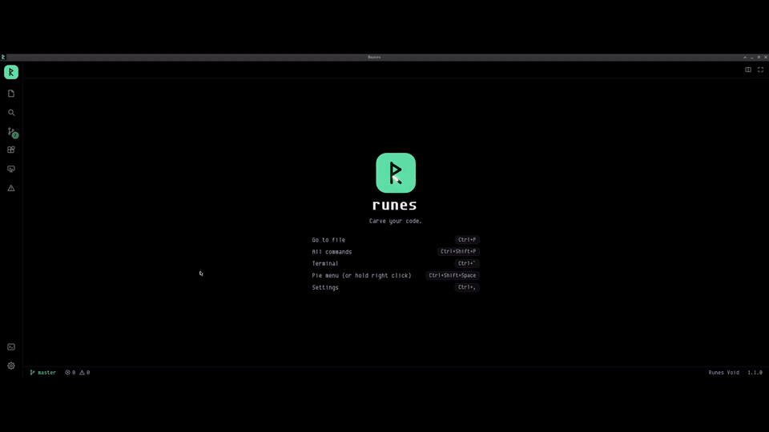
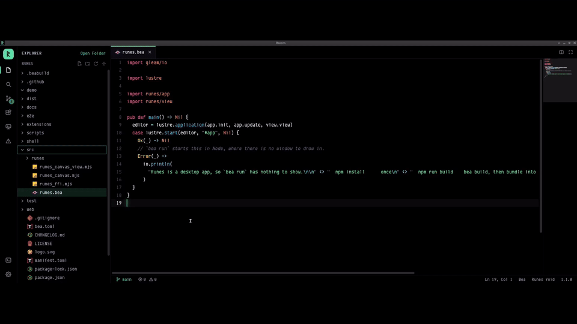
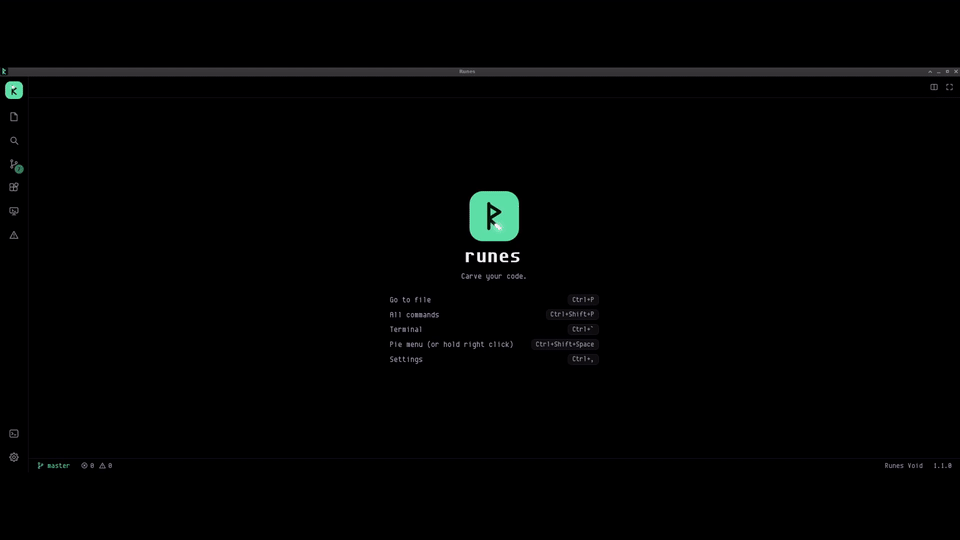
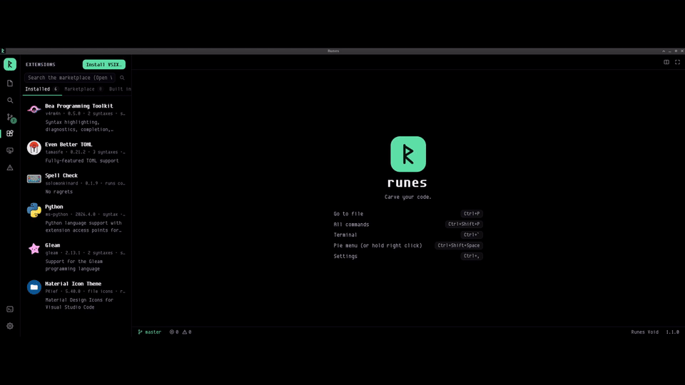
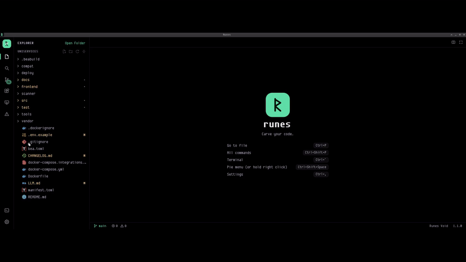

  

<h1 align="center">Runes</h1>

<b>An elegant, minimal code editor.</b> <i>Carve your code.</i>

<b>1.1.0</b> · Apache-2.0 · Linux, Windows, macOS

Runes ships with the essentials. Built in are syntax colouring for about thirty languages , two themes (Runes Void, dark, and Runes Glacier, light) and file icons. Language servers and everything else are installed
from the marketplace or from a `.vsix` file.

> Current stable Support is for Linux only & has been tested only with the Gleam Programming Language! Runes as an editor is in a very early stage of development and I get to work on this project during my free time so please don't expect a polished application. Positive feedback is welcome (you can open an issue)!

## Download Runes

**No need to build from source.** Grab a prebuilt binary from [GitHub Releases](https://github.com/the-bea-project/runes/releases) and start using Runes. Linux x64 is currently the tested platform.

[**Download the latest release**](https://github.com/the-bea-project/runes/releases/latest)

## Runes at a glance

### Modern minimalist editor with a familiar interface

A clean, familiar workspace with split panes, a block minimap and an integrated terminal.

### Pie menu

Hold the right mouse button or `Ctrl+Shift+Space` to open a customisable radial command menu.

### SSH sessions

Browse, edit and work on remote projects over SSH, without installing anything on the remote machine.

### Extensions

Install language support, themes and more from Open VSX or a local `.vsix` file.

### VCS history navigation & diff

Explore Git history, compare changes and travel through earlier versions of a file.

### Diagramming

Create a `.rux` file to draw diagrams, connect shapes and link them to your code with Rune Canvas.

## Run it

The following steps are for building from source. If you just want to use Runes, download the prebuilt release above instead.

    npm install        # Electron, the bundler, xterm, node-pty
    npm run build      # bea build, then bundle into dist/
    npm start          # open the editor; `npm start -- ~/code/project` opens a folder
    npm run package    # the app, unpacked, for this machine: release/<system>-unpacked/
    npm run release    # installers and archives, in release/ (see RELEASING.md)

`bea` and `gleam` must be on the PATH to build, and for the Bea and Gleam language servers.

## Current feature set

| Area | State |
|---|---|
| Editing | Several cursors; selection, undo/redo, auto-indent, auto-closing pairs, comment toggle, move and copy lines, snippets |
| Languages | Syntax for about thirty languages, from VS Code's own grammar extensions, plus Bea and Gleam. `extensions/bundled.json` lists them |
| Language servers | From installed extensions: diagnostics (squiggles, Problems panel, F8); completion with trigger characters, the server's ranges and filters, documentation and automatic imports; hovers drawn as Markdown; go to definition (F12); format document (Shift+Alt+F); fixes and refactorings under a light bulb and `Ctrl+.` |
| Tiling | Split right and down, drag a tab or a file to an edge to split, drag sashes to resize, maximise a group, side bar on either side, bottom panel |
| Minimap | Blocks rather than letters, a draggable viewport, error and warning marks |
| Search | Find and replace in the file (regex, case, whole word); search and replace across the folder |
| Terminal | Any number, in the panel or as tabs among the editors, named and searchable, running your shell (`terminal.shell` to choose another) |
| Pie menu | Hold the right mouse button, or Ctrl+Shift+Space; slices and submenus are edited in Settings (`runes.pie.items`) |
| Themes | Runes Void (dark) and Runes Glacier (light); any VS Code colour or icon theme can be installed |
| Explorer | New file and folder, rename, delete (to the trash), copy path; follows changes made by other programs; files coloured by how they stand with git |
| Source control | Stage, unstage, discard, commit (signed too), switch branch; blame in the status bar; name, email and signing in Settings; change marks in the gutter; comparison of commits, branches and files, inline or side by side, kept as sessions; time travel through a file; a graph of every branch with a calendar |
| SSH | Named sessions; the explorer, search, source control and terminals on the other machine, with nothing installed there |
| Marketplace | Open VSX, searched and installed from inside the editor |
| Font | EnvyCodeR Nerd Font, bundled (SIL Open Font License) |
| Settings | A settings page (Ctrl+,) over `settings.json`; `keybindings.json` in VS Code's format |
| Zoom | Ctrl+wheel changes the text size; Ctrl+= and Ctrl+- zoom the window |
| Rune Canvas | Drawings as `.rux` files in the project: shapes, tied arrows, labels, links to files, a hand-drawn or exact line; saved as readable JSON; PNG and SVG out |
| Markdown | A built-in preview (Ctrl+Shift+V), also used for extension readmes |
| Updates | Checks the latest GitHub release of one repository and links to it. Set `REPOSITORY` in `shell/update.cjs` |

## Hotkeys

The defaults are VS Code's: Ctrl+P files, Ctrl+Shift+P commands, Ctrl+` terminal, Ctrl+J panel,
Ctrl+B side bar, Ctrl+\ split, Ctrl+Shift+F search, Ctrl+Shift+M problems, Ctrl+, settings,
Ctrl+/ comment, Ctrl+Shift+L all occurrences, Ctrl+D next occurrence, Ctrl+. quick fix, Ctrl+Shift+V Markdown preview, Ctrl+K theme, Ctrl+Shift+I developer tools. Every command is in the palette, and
`keybindings.json` rebinds them.

## Extension compatibility

Runes installs `.vsix` files, from disk or from Open VSX (https://open-vsx.org). Microsoft's
Marketplace allows only Microsoft's own products to use it, so Runes does not; an extension
that is only published there (the Bea toolkit, at the time of writing) is installed from its
`.vsix` file, or can be published to Open VSX as well. What Runes does with an extension:

| Contribution | State |
|---|---|
| `languages`, `grammars` (TextMate), `snippets`, language configuration | Used |
| `themes`, `iconThemes` (font and image icons) | Used |
| `main`: the extension's code | Run in the extension host, with the part of the `vscode` API listed below |
| `configuration` | Defaults are read; your `settings.json` overrides them |
| `commands`, `keybindings`, `menus`, views, debuggers, tasks, webviews | Accepted, not shown or run yet |

The `vscode` API in `shell/exthost/vscode.cjs` is the surface `vscode-languageclient` needs:
documents and their events, diagnostics, the provider registry, configuration, output channels,
`Uri`, `Range`, `Position` and the other value types. Completion, hover, definition and
formatting providers are called by the editor. Every other `register…Provider` is accepted and
kept. An API Runes lacks resolves to a stand-in that does nothing, so an extension that touches
one keeps running rather than failing to load. This is not yet "any VS Code extension": UI
extensions (tree views, webviews, source control, debugging) load but have nowhere to draw.

## Layout of the code

    src/runes/buffer.bea      text as lines; insert, delete, slice, word motion
    src/runes/doc.bea         an open file and every edit made to it
    src/runes/layout.bea      the tree of tiles
    src/runes/keymap.bea      key chords and commands
    src/runes/settings.bea    settings.json
    src/runes/extension.bea   reading a VSIX's package.json
    src/runes/git.bea         the commit graph: lanes and the lines between commits
    src/runes/app.bea         the model and update
    src/runes/view.bea        everything drawn (Lustre)
    src/runes_ffi.mjs         the window's edge: keys, TextMate, minimap and terminal elements
    src/runes_canvas.mjs      Rune Canvas: a drawing as data. Reading, checking, writing, geometry
    src/runes_canvas_view.mjs Rune Canvas: the board, an element of the page
    shell/main.cjs            the Electron shell: one sandboxed window and what it may ask for
    shell/exthost/            the extension host process and its `vscode` module
    shell/files.cjs update.cjs vsix.cjs git.cjs market.cjs ssh.cjs
                              search, update check, VSIX reading, git, Open VSX, SSH
    shell/ask.cjs helpers/    how git, ssh and gpg put their questions to the window
    extensions/               extension sources; bundled.json names the ones that ship.
                              prebuilt/ holds the real Bea and Gleam packages for the tests

The editor itself is Gleam, written in its Bea dialect (`src/runes/*.bea`). The shell and the extension host are JavaScript, because they are
Node and Electron glue and because extensions expect a Node `require("vscode")`.

## Tests

    npm test                           # Bea unit tests, shell and canvas unit tests, extension host test
    xvfb-run -a npm run test:app       # 71 end-to-end checks of the real app (Playwright)
    RUNES_ELECTRON=out/Runes-linux-x64/Runes xvfb-run -a npm run test:app   # the packaged app

`npm run test:app` needs Playwright (`npm i -D playwright`), and `--no-sandbox` is passed
because CI containers run as root. See SECURITY.md for the security review.

## Upcoming features 

- Code folding, bracket matching, word wrap.
- Rename, references, signature help, semantic highlighting (the providers are
  registered by extensions already; the editor does not call them yet).
- Floating windows. Tiles split, resize, maximise and move, but stay inside the one window.
- `.sublime-syntax` grammars. TextMate grammars (`.tmLanguage`, JSON or plist) are supported,
  which is what VS Code extensions ship.
- Git: push, pull, fetch and stash are not there yet. Use the terminal for those.
- The explorer: dragging files between folders, copy and paste of files, and choosing several
  at once.
- Debugger.
- Downloading and installing an update by itself. The check tells you and opens the release.
- Windows and macOS builds have not been run. Nothing in the code is Linux-only, but only the
  Linux x64 build was tested.
- Wide characters and emoji put the caret off by a cell.
- Enabling/disabling extensions
- Jump to function & list  as jump list
- Smart indentation support & indent level markers
- Reload editor function
- File drag drop into runes' file-explorer

## Under consideration

- MCP
- Agentic workflows for building software in editor with Runes tools

## Third-party

`extensions/` holds grammar and theme extensions from microsoft/vscode (MIT, see
`extensions/VSCODE-LICENSE.txt`), the Bea extension (Apache-2.0) and the Gleam extension
(Apache-2.0). EnvyCodeR Nerd Font is under the SIL Open Font License (`web/fonts/`).